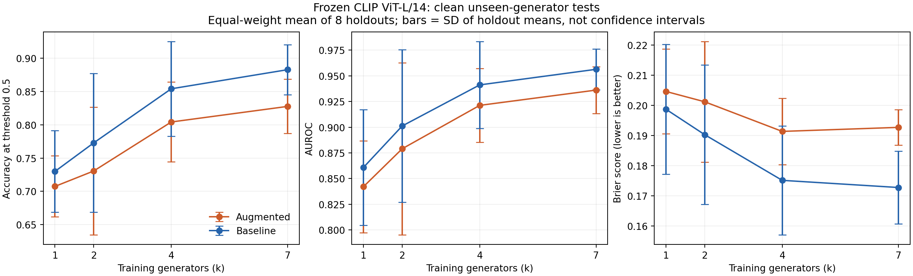

# CSCI566 - AI-Generated Image Detection

Does training on more image generators improve detection of an unseen generator?
We compare a fine-tuned ResNet-50 with frozen CLIP ViT-L/14 features and a
supervised linear classifier using GenImage and shared experiment splits.
The number of training generators varies across **k = 1, 2, 4, 7**, while the
total training set stays fixed.

## Current status

**Verified November 8, 2026: the corrected 192-run ViT benchmark is complete.**
All clean test evaluations passed the final CARC audit. The published analysis
export also checked all **384 validation/test prediction files (215,040 rows)**
against the exact manifests, labels and recorded metrics.

| Component | Status |
|---|---|
| Corrected dataset | 96 experiments, 288 split CSVs, fixed test membership per holdout, shared real partitions, release hashes and acceptance checks |
| ViT clean benchmark | 192 completed runs: 8 holdouts x 4 k values x 3 dataset repeats x 2 training modes |
| Published ViT analysis | Per-run results/settings, image-level predictions, training histories, calibration, paired augmentation differences and figures |
| CNN comparison | Current notebook uses the corrected benchmark; 47 completion markers/test exports were observed on CARC during the November 8 review, pending independent audit |
| Degraded-image evaluation | Remaining: evaluate the saved models under JPEG, blur, resize, noise and filtering conditions |
| Report and extensions | Matched CNN-ViT analysis, error/calibration discussion and final report/poster remain; additional proposed methods require a scope decision |

The CNN count is a dated observation and can change as its team's work continues.
The accepted ViT clean study is ready for analysis; use its published exports.

## Start here

| Need | Read |
|---|---|
| Completed ViT results, data dictionary and interpretation | [Benchmark analysis handoff](results/vit_benchmark/README.md) |
| Detailed remaining work and suggested team responsibilities | [November 8 review](docs/vit-status-2026-11-08.md) |
| Dataset design, acceptance checks and reproducibility | [Corrected benchmark guide](docs/benchmark.md) |
| Exact manifests and raw analysis archives | [Drive handoff](https://drive.google.com/drive/folders/155zGH4KJr_cifkuqI29l0BbEocfMlb74) |
| CARC environment and shared storage | [CARC setup](docs/carc.md) |
| ViT notebook and runner | [ViT guide](docs/vit.md) |
| CNN workflow | [CNN notebook](cnn.ipynb) |
| CNN k=7 JPEG/resize robustness evaluation | [Robustness notebook](CNN_K7_Robustness_Evaluation.ipynb) |
| Original dataset workflow | [Dataset notebook](GenImage_Final_Dataset_Workflow.ipynb) |
| Earlier ADM-only study | [Archived pilot results](results/vit_master_v1/README.md) |

**Drive access:** the handoff was uploaded to the connected account's My Drive.
At verification it was private; creation under the original shared dataset
folder returned `403 insufficientParentPermissions`. An editor must share or
move the handoff so teammates can access it.

## Clean ViT results

Each value is the equally weighted mean across eight held-out generator variants,
after averaging three dataset repeats within each holdout. Accuracy uses a fixed
decision threshold of 0.5.

| Training generators (k) | Baseline accuracy | Augmented accuracy | Baseline AUROC | Augmented AUROC |
|---|---:|---:|---:|---:|
| 1 | 73.00% | 70.74% | 0.8608 | 0.8420 |
| 2 | 77.29% | 73.07% | 0.9012 | 0.8790 |
| 4 | 85.42% | 80.43% | 0.9412 | 0.9212 |
| 7 | 88.30% | 82.78% | 0.9564 | 0.9361 |

Average clean performance improves with k for both modes; individual holdouts
can behave differently. The combined augmentation recipe scores lower on clean
tests at each k. Its intended robustness benefit still needs degraded-image
evaluation. Raw probability calibration also remains imperfect.



The figures' error bars show variation across holdout means. Dataset repeats
reuse test images and real partitions, and every run uses classifier seed 17.
Account for these dependencies when estimating uncertainty. Stable Diffusion
1.4 and 1.5 are related variants. JPEG settings are matched, while compression
history, image size, semantic content and undetected related images remain
potential confounds. Conclusions concern this corrected benchmark.

## Find the analysis data

| File or folder | Use |
|---|---|
| [All clean test results](results/vit_benchmark/summary/all_results.csv) | 192 rows with classification/calibration metrics, confusion counts and protocol hashes |
| [Full run details](results/vit_benchmark/summary/run_details.csv) | Test/validation metrics, training-generator combinations, best epochs, settings and environment |
| [Per-holdout summaries](results/vit_benchmark/summary/by_holdout_k.csv) | Mean, SD and count across dataset repeats |
| [Macro summaries](results/vit_benchmark/summary/macro_across_holdouts.csv) | Equal-weight holdout averages and variation |
| [Paired augmentation differences](results/vit_benchmark/summary/augmentation_deltas.csv) | Augmented-minus-baseline differences within each experiment |
| [Prediction exports](results/vit_benchmark/predictions/) | Gzip CSVs containing all validation/test probabilities and image identities |
| [Training/calibration metadata](results/vit_benchmark/metadata/) | Epoch histories, reliability bins, original run records, audit reports and checksums |
| [Figures](results/vit_benchmark/figures/) | Performance versus k, holdout AUROC heatmaps and raw reliability |

Read compressed tables directly with `pandas.read_csv(path)`. Keep validation and
test analyses separate. For model comparisons, verify the dataset release and
image coverage, then join by experiment, seed, split and SHA-256 `image_id`
within the selected training treatments. Check labels before computing paired
metrics. The older ADM CNN tables under `results/cnn_outputs/` belong to the
pilot and use different splits; collect the corrected-benchmark CNN exports.
Document each model's actual preprocessing, augmentation and training settings.

## Exact dataset and CARC artifacts

The benchmark uses eight generator variants: ADM, BigGAN, GLIDE, Midjourney,
Stable Diffusion 1.4, Stable Diffusion 1.5, VQDM and Wukong. One variant is held
out from fake training and validation. Each experiment has 1,400 real + 1,400
fake training images; validation and test each contain 280 real + 280 fake images.

Large artifacts live under `/project2/yzhao010_1531/csci566-genimage`:

| Artifact | Relative path |
|---|---|
| Image root | `data/extracted/GenImage_Compact/` |
| Exact benchmark split CSVs | `data/extracted/GenImage_Compact/benchmark/manifests/` |
| Release plan, fingerprint and image inventory | `data/extracted/GenImage_Compact/benchmark/` |
| Full ViT results and saved classifier heads | `results/vit_benchmark/<holdout>/runs/` |
| ViT frozen-feature cache | `features/vit_benchmark/<holdout>/` |
| Corrected CNN outputs | `results/cnn_benchmark/notebook/` |
| Earlier ViT pilot | `results/vit_master_v1/` |

The Drive manifest archive contains the exact `benchmark/` directory and its
hashes. It contains image lists; obtain the images separately and preserve their
relative paths. Real images use the original generator folders; fake images use
the existing `_release_v2/jpeg_ai/` derivatives. Verify image hashes before
training on a new machine. Images, feature caches and checkpoint binaries remain
on CARC; the GitHub handoff contains analysis exports. Preserve a durable backup
of the accepted checkpoints.

## Reproduce the workflow

The [master notebook](ViT_Master_Experiments.ipynb) and
[batch runner](code/vit/run_vit_master.py) use `code/vit/engine/`.
The [benchmark guide](docs/benchmark.md) documents environment setup, preflight,
isolated GPU smoke checks, training/resume and the final audit. Coordinate study
ownership before launching work; each holdout permits one output writer.
Earlier starter notebooks are kept under [archive/vit/](archive/vit/).

To recreate analysis tables from extracted handoff archives:

```bash
python code/vit/export_analysis.py --source PATH/vit_benchmark --benchmark PATH/benchmark --output results/vit_benchmark
python code/vit/plot_analysis.py --root results/vit_benchmark
```

See the [current work review](docs/vit-status-2026-11-08.md) for robustness,
matched CNN comparisons, uncertainty, calibration and reporting tasks. The
[older team plan](docs/team-plan.md) preserves the historical planning snapshot.
