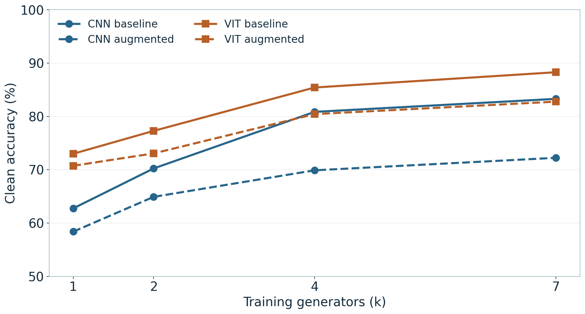
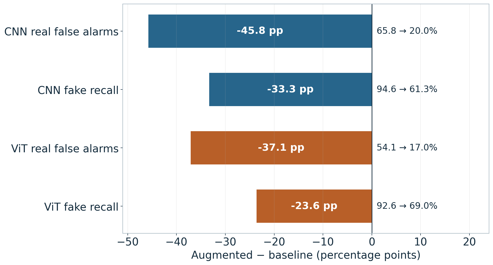
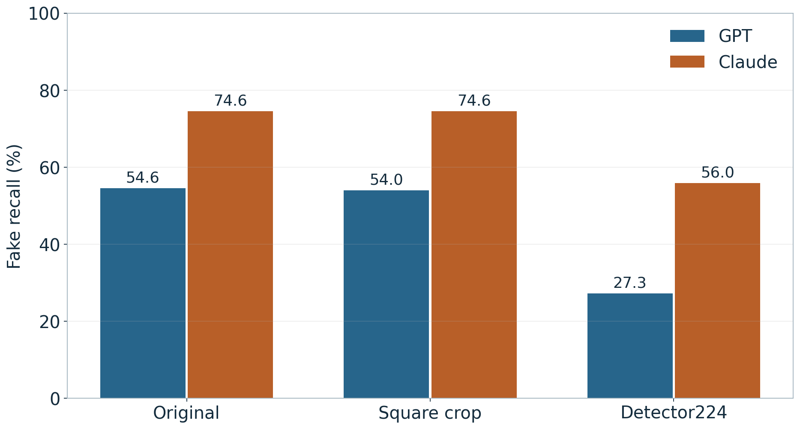
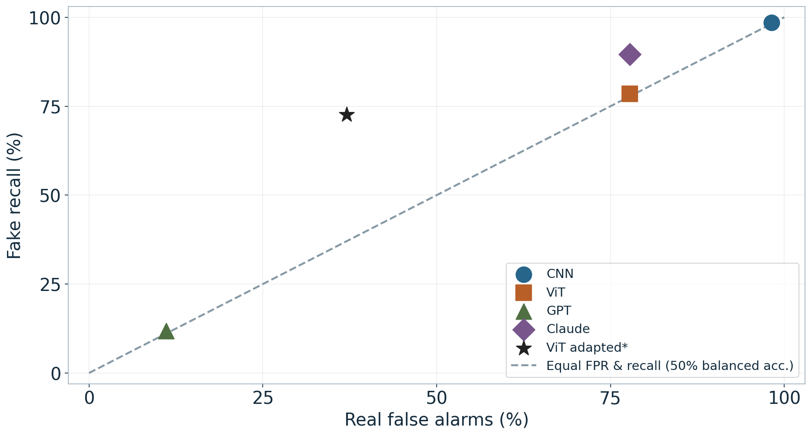

# Generalization of AI-image detectors across generators, presentation and manipulation

**Team review draft — updated 27 November 2026.** This draft summarizes verified
artifacts and identifies preliminary findings. Confirm the final course format,
authorship, citations, figures and any teammate contributions before submission.

Shriya Rajesh, Jeslyn Yang, Aditya Lanjewar, Jad Barmada, Saisha Hongal, Medini Patil, Rachel Lin (authorship order follows the submitted proposal and midterm; team confirmation pending).

**Evidence status:** the November 26 independent audit matched the CNN, ViT,
GPT and Claude GenImage scores by source SHA-256 and verified the saved CNN
archive checksums. The audit also recomputed all seven face configurations.
The tables below incorporate those results. The GPT GenImage original
attempt-level log remains unavailable; no independent retry, cost or API
settings claims are made. See the [audit](../llm_eval/team_readiness_2026-11-26/README.md).

## Abstract

We investigate how AI-image detectors generalize when the generator, image
presentation and type of manipulation change. Under a fixed training budget,
a fine-tuned ResNet-50 and a frozen CLIP ViT-L/14 with a linear head are
compared across 192 matched run pairs. Increasing training diversity from
one to seven generators raises mean clean accuracy from 62.75% to 83.30%
(CNN) and from 73.00% to 88.30% (ViT). Augmentation improves mean JPEG60
and resize accuracy but reduces clean accuracy; at JPEG60 it reduces both
false alarms and fake recall, with little change in ViT AUROC. On 590 common
valid GenImage sources, GPT and Claude fake recall drops from 54.62% and
74.62% in the original view to 27.31% and 55.96% at detector224, respectively.
On 189 exploratory DF40 face crops, baseline CNN and ViT have approximately
50% balanced accuracy despite high fake recall; GPT achieves similarly low
balanced accuracy while missing most fakes. A supervised face-adapted head
achieves 67.78% balanced accuracy but was not tested on an independently
verified identity-disjoint sample. These results distinguish generalization
across generator distributions from robustness to image processing and
cross-task transfer. They motivate reporting both class-specific errors and
threshold-independent ranking, not accuracy alone.

## Research question and context

Our central question is **how well AI-image detectors generalize when the generator, image presentation, and type of manipulation change**. The fixed-budget unseen-generator test answers the first part; degradation and paired input views answer the second; face-manipulation transfer answers the third. Prior work
motivates both the diversity hypothesis and the risk of dataset artifacts in
AI-image detection [1–3]. We additionally test robustness to post-processing
and transfer from generated images to manipulated faces [4].

## Data and experimental design

The corrected GenImage benchmark has eight held-out generators, four values
of k (1, 2, 4, 7), three dataset repeats and baseline/augmented modes. It
contains 96 split manifests and 192 runs for each detector. Each run has
1,400 real and 1,400 fake training images, 280 of each class for validation,
and 280 of each class for test. Fake test images come from the held-out
generator. The two pipelines share the image manifests. The same test images
and some real partitions recur across settings, and all runs use seed 17.
Dataset repeats are not independent classifier-seed trials.

The CNN is an ImageNet-pretrained ResNet-50 fine-tuned for binary detection.
The ViT uses a frozen CLIP ViT-L/14 image encoder and a supervised linear
classifier [5]. Augmentation is pipeline-specific: CNN uses crop/flip, while the ViT uses blur, JPEG, resize, noise and low-pass operations. Thus differences cannot be assigned solely to architecture or to an identical augmentation policy. These are complete-pipeline comparisons, so pretraining,
architecture and fine-tuning differ. Both pipelines use threshold 0.5 for
the standard benchmark. For each k and mode, we average the three repeats
within each holdout and then weight the eight holdouts equally.

## Clean held-out-generator results

| k | CNN baseline accuracy | CNN augmented accuracy | ViT baseline accuracy | ViT augmented accuracy |
| ---: | ---: | ---: | ---: | ---: |
| 1 | 62.75% | 58.39% | 73.00% | 70.74% |
| 2 | 70.25% | 64.92% | 77.29% | 73.07% |
| 4 | 80.86% | 69.90% | 85.42% | 80.43% |
| 7 | 83.30% | 72.24% | 88.30% | 82.78% |

| k | Mode | CNN fake F1 | ViT fake F1 | CNN AUROC | ViT AUROC |
| ---: | --- | ---: | ---: | ---: | ---: |
| 1 | augmented | 0.2957 | 0.5737 | 0.6757 | 0.8420 |
| 1 | baseline | 0.3866 | 0.5867 | 0.7358 | 0.8608 |
| 2 | augmented | 0.4682 | 0.6113 | 0.7229 | 0.8790 |
| 2 | baseline | 0.5462 | 0.6763 | 0.7977 | 0.9012 |
| 4 | augmented | 0.6286 | 0.7545 | 0.7862 | 0.9212 |
| 4 | baseline | 0.7710 | 0.8261 | 0.8906 | 0.9412 |
| 7 | augmented | 0.6785 | 0.7997 | 0.8048 | 0.9361 |
| 7 | baseline | 0.8167 | 0.8741 | 0.9007 | 0.9564 |

**Figure 1.** Clean accuracy as training-generator diversity increases. Lines show the four CNN/ViT training configurations; repeated holdout images are not independent trials.

All 192 CNN and 192 ViT runs passed their original audits. An additional
matched analysis checked 107,520 test-image pairs by SHA-256 and label and
recomputed accuracy, AUROC, Brier score and 10-bin expected calibration error.
At k=7 baseline, mean AUROC was 0.9007 for CNN and 0.9564 for ViT. Mean
10-bin ECE was 0.1138 for CNN and 0.2816 for ViT; calibration error depends on
the binning and aggregation method. These summaries do not establish an
architecture-only effect.

## Compression and resize robustness

The k=7 evaluation applies JPEG quality 60 or a bicubic 224→112→224 resize
after the common geometry and before normalization. The completed ViT study
contains 48 clean references and 96 degraded evaluations. ViT baseline mean
accuracy was 88.30% clean, 69.24% JPEG and 56.96% resize. ViT augmented mean
accuracy was 82.78%, 75.99% and 81.85%, respectively.

The JPEG accuracy gain conceals an operating-point tradeoff. At threshold 0.5,
equal-weight mean real-image false-positive rate fell from 54.11% to 17.02%,
while fake recall fell from 92.59% to 69.00%. Mean AUROC changed from 0.84987
to 0.84941. These comparisons use separately trained models, and the same test
images recur across repeats. A descriptive test-ROC comparison at 10% empirical
false-positive rate gives 58.78% baseline versus 60.49% augmented mean recall;
it uses the test labels to find operating points and is not independent
threshold calibration. See the [paired analysis](poster_assets/JPEG_ERROR_ANALYSIS.md).

The matching CNN study covers all eight holdouts. After an initial P100 replay
failed the 0.001 maximum-score tolerance for four holdouts, the affected 24
checkpoints were rerun on V100. All reproduced their original clean scores
exactly, and the 72 new clean/JPEG/resize evaluations passed an independent
audit. The original P100 results are preserved. The validated CNN baseline
mean accuracy was 83.30% clean, 64.43% JPEG, and 50.20% resize; the augmented
CNN achieved 72.24%, 70.65%, and 68.85%, respectively. These are equally
weighted averages across eight holdouts after averaging three repeats. The CNN
shows the same JPEG operating-point tradeoff as the ViT: at threshold 0.5,
real false positives fell from 65.79% to 20.01% while fake recall fell from
94.64% to 61.32%. Both class-specific rates fell in all eight holdout means
for each pipeline. These descriptive results compare separately trained
models and do not isolate architecture or establish a cause. See the
[class-specific analysis](poster_assets/JPEG_ERROR_ANALYSIS.md). GPU
differences explain the observed replay mismatch in the tested setup; see
[the audit](cnn_robustness_v100/README.md).

**Figure 2.** JPEG60 class-specific changes at k=7 and threshold 0.5.
A decrease in real false alarms is beneficial; a decrease in fake recall is
not. Values are descriptive holdout means.

## Matched vision-language comparisons on GenImage

The shared six-configuration comparison joins existing clean CNN and ViT
k=7/repeat-0 detector outputs and the GPT/Claude detector224 views by source
SHA-256 and label. All 16 CNN exports match their archived checksums.
Of 630 source images, 612 have valid scores in both VLMs (70 real, 542 fake).
The 18 invalid GPT detector224 responses are all fake. The real sources
recur across holdouts; the 1,102 holdout rows per configuration are not
1,102 independent images. Metrics below are equal-weight holdout means.
Detector preparation is model-specific, so this is source-matched and
approximately geometry-matched, not identical tensor input.

| Model | Fake recall | Real false alarms | Balanced accuracy | Mean AUROC |
| --- | ---: | ---: | ---: | ---: |
| ViT baseline | 82.67% | 3.93% | 89.37% | 0.9680 |
| CNN baseline | 80.45% | 9.29% | 85.58% | 0.9219 |
| ViT augmented | 69.71% | 2.14% | 83.79% | 0.9516 |
| Claude detector224 | 55.59% | 0.00% | 77.79% | 0.9520 |
| CNN augmented | 65.38% | 13.75% | 75.82% | 0.8444 |
| GPT detector224 | 26.80% | 0.00% | 63.40% | 0.9303 |

The separate four-frontier original-view pilot has 88/90 common valid
sources (10 real, 78 fake). Equal-weight holdout balanced accuracy is
93.06% ViT baseline, 88.96% Claude, 85.14% ViT augmented, 83.82% Gemini,
80.28% CNN baseline, 76.39% GPT, 76.32% Groq-Qwen and 71.18% CNN augmented.
Model prompts and preprocessing are not identical; this small pilot is not
a general frontier leaderboard. The separately attempted 2,520-image protocol
is incomplete and excluded. Full values and source provenance are in the
[matched audit](../llm_eval/team_readiness_2026-11-26/README.md).

### Image presentation

The paired three-view analysis uses only the 590 sources with all six
valid GPT/Claude scores (70 real, 520 fake). The models are GPT
`gpt-6.2-sol` and Claude `claude-opus-5-5`; score threshold is 50/100.

| Model | View | Fakes detected /520 | Fake recall | AUROC |
| --- | --- | ---: | ---: | ---: |
| GPT | Original | 284 | 54.62% | 0.9907 |
| GPT | Square crop | 281 | 54.04% | 0.9875 |
| GPT | Detector224 | 142 | 27.31% | 0.9333 |
| Claude | Original | 388 | 74.62% | 0.9998 |
| Claude | Square crop | 388 | 74.62% | 0.9962 |
| Claude | Detector224 | 291 | 55.96% | 0.9532 |

Both models falsely flag 0/70 reals in all three views. Although all 560 fake
original images were square and 69/70 real originals were non-square,
the square crop preserves much of the observed ranking; the lower recall in
the detector224 view demonstrates sensitivity to the combined input-processing
intervention, not an isolated causal effect of resolution. GPT has 46 invalid
image-view outputs, all on fakes (13 original, 15 square, 18 detector224).
Metrics are conditional on valid responses and cannot be interpreted as
full-cohort effectiveness.

**Figure 3.** Fake recall on fixed paired sources across three views.

## Confidence and calibration

The integrated analysis checks raw ViT test metrics for all 192 runs.
At k=7, baseline ViT accuracy is 88.30% and mean ECE is 0.2816, indicating
poor confidence calibration despite strong ranking. Fit temperature scaling
on validation data only (Guo et al. [6]); the test class decisions at threshold
0.5 remain unchanged, but confidence changes. For baseline k=7, ECE falls
to 0.0676 and log loss from 0.5338 to 0.2911. At k=1 the mean log loss instead
increases from 0.5861 to 1.0429. Validation fake generators are seen during
training, so a calibration rule fitted there need not transfer to the unseen
generator. The effect differs across diversity settings. These are descriptive
differences; the existing bootstrap draws shared reals separately across
holdouts, so we do not quote its overall confidence intervals.

Error analysis also finds that at baseline k=7 missed-fake rates vary from
3.6% (GLIDE) to 26.1% (SD 1.4). The 192 runs reuse test images; no independent
seed-level generalization is claimed. See the [calibration and error analysis](../analysis/README.md).

## Face-manipulation transfer

In a subsequent exploratory 189-image FaceForensics++-derived comparison,
the five frozen model variants were tested on 54 real crops and 27 crops for
each of five manipulation labels. A P100 replay passed reference checks. At
threshold 0.5, the baseline CNN, baseline ViT and face-adapted ViT head
flagged 53, 42 and 20 of the same 54 real crops, respectively. Fake-detection
counts varied by method; all counts and the preselected validation-threshold
results are in the [five-method results](new_data/fresh_candidate_results_v3/README.md).
Person-level independence, source roles and some mirror method labels remain
unverified; three video-ID pairs were excluded before scoring. The adapted
head trained on three evaluated methods, so this small follow-up does not
establish a reliable general adaptation improvement.

A subsequent zero-shot OpenAI Responses API evaluation used model
`gpt-6.1-terra` on those exact 189 image hashes, one image per request, with a
fixed face-manipulation prompt and threshold 50/100. All predictions and the
1,134-row, six-model comparison passed the independent result audits; local
regeneration reproduced every summary/comparison CSV exactly. No retraining,
prompt tuning or threshold tuning was performed for this run.

| Model/configuration | Accuracy | Balanced accuracy | AUROC | Real falsely flagged /54 | Fakes detected /135 |
| --- | ---: | ---: | ---: | ---: | ---: |
| OpenAI, zero-shot | 33.86% | 50.37% | 0.5783 | 6 | 16 |
| CNN, baseline | 70.90% | 50.19% | 0.5690 | 53 | 133 |
| CNN, augmented | 60.85% | 55.37% | 0.5227 | 31 | 92 |
| ViT, baseline | 62.43% | 50.37% | 0.4930 | 42 | 106 |
| ViT, augmented | 58.73% | 49.44% | 0.5221 | 39 | 96 |
| ViT, face-adapted (supervised reference) | 69.84% | 67.78% | 0.7583 | 20 | 98 |
| Claude, zero-shot | 70.37% | 55.93% | 0.6198 | 42 | 121 |

OpenAI's real-image false-positive rate was 11.11%, but its fake recall was
only 11.85%: it missed 119/135 manipulated crops. It detected 6/27 SimSwap,
3/27 FOMM, 3/27 Wav2Lip, 3/27 InSwapper and 1/27 PIRender crops. The baseline
CNN and ViT showed more real false alarms and higher fake recall. Because
135/189 images are fake, always predicting fake would achieve 71.43% accuracy
but 50% balanced accuracy; raw accuracy does not establish a useful detector
or a model ranking. The 54 real crops are shared across all method summaries,
and the crops are linked by source-video groups. OpenAI scores are prompted
estimates, not calibrated probabilities. This single model/prompt comparison
does not resolve the candidate's identity or method-label limitations. The
[complete exports and analysis](openai_face/df40_five_method_v3_v2/README.md)
preserve the protocol, raw scored responses, per-method metrics and audits.

Claude (`claude-opus-5-5`) also completed all 189 frozen images with the same
face prompt and threshold. Its 121/135 fake detections came with 42/54 real
false alarms. The independent audit verified matching image hashes and
identical shared detector predictions between the two exports. Unlike
GenImage GPT (`gpt-6.2-sol`), the face GPT model is `gpt-6.1-terra`; do not
treat the paired studies as identical provider configurations.

**Figure 4.** Real false alarms versus fake recall on the matched face crops.
Above the diagonal indicates balanced accuracy greater than 50%; the
supervised adapted head is exploratory, not a zero-shot baseline.

An additional exploratory still-photo test used 50 IMDB-WIKI real photos and
50 matched-path outputs for each of InsightFace and Stable Diffusion inpainting
from DeepFakeFace. At threshold 0.5, the baseline CNN falsely flagged 23/50
reals and detected 31/50 InsightFace and 34/50 inpainting samples; the baseline
ViT falsely flagged 4/50 and detected 28/50 and 33/50, respectively. The
augmented models and AUROC values are in the [still-photo results](still_face_v1/README.md).
The differing samples cannot explain the DF40 real-image errors. In this sample
all fake files were 512x512 while real files varied in size, introducing a
potential class-correlated shortcut. Source-image and identity overlap and
successful face edits are not independently established.
In a paired follow-up applying a common square crop, 512x512 resize, and JPEG
encoding to all images, baseline CNN real false positives changed from 23/50
to 28/50 and ViT from 4/50 to 6/50. This combined intervention cannot isolate
the effects of any one processing operation or identify camera effects; see
[the processing follow-up](still_face_uniform_v1/README.md).
Subsequent separate, post-hoc geometry-only and JPEG-quality-95 tests showed
that geometry changed five baseline CNN and one baseline ViT real decisions,
while that JPEG variant changed none. This is limited to these 50 reals and
these settings; see [factor analysis](still_face_geometry_v1/README.md).

The first DF40 subset contains 100 real Celeb-DF crops, 200 SimSwap, 100 FOMM
and 100 Wav2Lip crops. The 100 real images are reused for each per-method
comparison. Existing CNN and ViT models were evaluated without retraining.
At the original threshold, real-image false-positive rates were 99% for
baseline CNN, 57% for augmented CNN, 90% for baseline ViT and 83% for
augmented ViT. The fixed-prompt zero-shot CLIP baseline produced 24% false
positives, but detected 43% of SimSwap, 60% of FOMM and 27% of Wav2Lip.
Results apply to this subset and do not represent all DF40 methods.

A second subset uses the FaceForensics++ portion of DF40. Validation and test
each contain 70 real images and 70 fake images per method. The selection keeps
known video-ID pairs in the same partition; person-level independence is not
established. Thresholds targeting at most 10% validation-real false positives
were frozen before test inference. A new supervised linear head trained on
separate FF crops achieved 4/70 test real false positives and detected 31/70
SimSwap, 51/70 FOMM and 15/70 Wav2Lip images. The earlier zero-shot CLIP
baseline had 9/70 false positives and detected 21/70, 24/70 and 11/70,
respectively. All three fake methods appeared in face-adaptation training.
The FF test was previously inspected, so this is an exploratory follow-up.
The adapted-head job's final summary write failed; a separate replay reproduced
its validation selection and test predictions exactly, and the failure is
recorded in the experiment log.

## Exploratory model comparisons

An open Qwen2.5-VL-3B vision-language model was evaluated using one fixed
prompt on 32 real and 32 ADM fake images from the shared test set. It answered
all 64 and achieved 42/64 accuracy, with 1/32 real false positives and 11/32
fake detections. The matched baseline CNN and ViT achieved 48/64 and 61/64,
respectively. This one-model, one-prompt, one-generator sample is too small
for broad rankings. Image preprocessing differs among model families.

On the k=7 repeat-0 frozen CLIP features for all eight holdouts, a common
feature adapter was trained with binary loss, a generator-adversarial loss,
or supervised contrastive loss. After the first seed, two optimization seeds
were added. Averaging three seeds within each holdout and then across holdouts,
test accuracy was 0.9162, 0.9185 and 0.9150, with mean AUROC 0.9742, 0.9741
and 0.9742, respectively. Adversarial accuracy was higher in five holdouts and
lower in three. The extension and additional seeds were decided after seeing
previous results; the test sets were previously examined, and just one dataset
repeat was used per holdout. These exploratory findings do not establish a
reliable improvement. The CLIP backbone was frozen.

## Limitations and next checks

The test data are reused across several analyses and selection decisions.
Celebrity identities and source videos may overlap within DF40 subsets.
The held-out FF video IDs are separated, but person independence is unknown.
Fake labels follow released dataset provenance and do not prove that each
frame exhibits a successful manipulation. Face crop preprocessing and source
differences can create confounding cues. Qwen and OpenAI each represent one
model with one prompt on small selected subsets, not a broad ranking of open
or proprietary vision-language systems. OpenAI's low false-positive rate
accompanied low fake recall; a passed output audit does not certify the
underlying dataset labels or independence. The CNN
robustness rerun passed the original replay tolerance; the earlier P100 results
and their discrepancy are retained for provenance. The regularized objectives
need more dataset repeats and a fresh test before claims about improvement.

## Conclusion

Within the corrected GenImage benchmark, increasing the generator diversity
at fixed image budget improved average unseen-generator discrimination for
both model pipelines. This reproduces the direction of prior larger-scale
diversity work [2] rather than claiming a new universal law. Our presentation
tests show that changes in accuracy can conceal changes in which errors the
detectors make. The face experiments show that transfer to partial image
manipulation remains unreliable on the selected datasets, even when clean
GenImage results are strong. We do not establish that image shape, cameras,
or any particular feature caused the face errors. A fresh, provenance-checked
identity-disjoint face benchmark and a separately calibrated threshold are
natural next tests; additional adaptation must be evaluated on an untouched
test set.

## Reproducibility and contributions

The repository includes manifests, corrected prediction exports, reference
replay audits, analysis scripts, and the [final delivery package](../../docs/final_delivery/README.md).
Figures regenerate from these saved results without new model calls or
training. The final author contribution statement, submission format and
team sign-off must be confirmed by each team member before submission; the
[contribution/merge inventory](../../docs/project-review-2026-11-26.md)
and [backlog](../../BACKLOG.md) preserve the current technical evidence.

## References

1. Zhu et al. [GenImage: A Million-Scale Benchmark for Detecting AI-Generated Image](https://papers.neurips.cc/paper_files/paper/2023/file/f4d4a021f9051a6c18183b059117e8b5-Paper-Datasets_and_Benchmarks.pdf). NeurIPS 2023.
2. Park and Owens. [Community Forensics: Using Thousands of Generators to Train Fake Image Detectors](https://openaccess.thecvf.com/content/CVPR2025/html/Park_Community_Forensics_Using_Thousands_of_Generators_to_Train_Fake_Image_CVPR_2025_paper.html). CVPR 2025.
3. Grommelt et al. [Fake or JPEG? Revealing Common Biases in Generated Image Detection Datasets](https://arxiv.org/abs/2403.17608). 2024.
4. Yan et al. [DF40: Toward Next-Generation Deepfake Detection](https://proceedings.neurips.cc/paper_files/paper/2024/hash/34239f60eca7ce9bee5280aaf81362d8-Abstract-Datasets_and_Benchmarks_Track.html). NeurIPS 2024.
5. Radford et al. [Learning Transferable Visual Models From Natural Language Supervision](https://proceedings.mlr.press/v139/radford21a.html). ICML 2021.

6. Guo et al. [On Calibration of Modern Neural Networks](https://proceedings.mlr.press/v70/guo17a.html). ICML 2017. DOI: [10.48550/arXiv.1706.04599](https://doi.org/10.48550/arXiv.1706.04599).

Detailed provenance, raw scores, model-selection records and the current error
status are linked from [the experiment log](FINAL_REPORT_EXPERIMENT_LOG.md).
