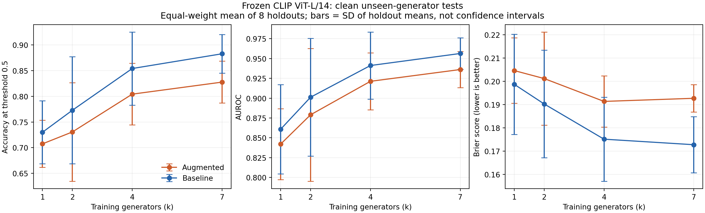

# Completed ViT benchmark: analysis handoff

Verified November 8, 2026. All **192 training runs and clean test evaluations**
finished. The CARC final audit passed November 6; this export independently
rechecked 384 validation/test prediction files, **215,040 prediction rows**,
manifest hashes, identities, labels, thresholded predictions and saved metrics.

Frozen CLIP ViT-L/14 with normalized features and a supervised linear head;
8 held-out generator variants x 4 k values x 3 dataset repeats x 2 modes.
Classifier seed is 17 throughout. Dataset fingerprint:
`860156cea9b208a42fb9d481000b40864924d920700a4db00a50d44bd28c6bb6`.

## Which file to use

| File | Contents / analysis supported |
|---|---|
| [summary/all_results.csv](summary/all_results.csv) | Original 192 clean-test rows; accuracy, fake precision/recall/F1, AUROC, ECE, Brier, log loss, TN/FP/FN/TP, hashes and CARC paths |
| [summary/run_details.csv](summary/run_details.csv) | All results plus validation metrics, generator combinations, best epoch, recorded epochs, training settings, software versions, preprocessing, protocol/release hashes and completion times |
| [summary/by_holdout_k.csv](summary/by_holdout_k.csv) | 64 holdout/k/mode groups; mean, sample SD and count across three dataset repeats |
| [summary/macro_across_holdouts.csv](summary/macro_across_holdouts.csv) | 8 k/mode groups; equally weighted holdout means, SD across eight holdout means and count |
| [summary/augmentation_deltas.csv](summary/augmentation_deltas.csv) | 96 paired augmented-minus-baseline differences on the same experiment/test images |
| [summary/validation_test_gaps.csv](summary/validation_test_gaps.csv) | Per-run validation-minus-test metrics; descriptive seen-validation versus unseen-test gaps |
| `summary/heatmap_*.csv` | Plot-ready holdout by mode/k accuracy, AUROC, F1 and fake recall |
| [predictions/](predictions/) | Eight gzip CSVs, one per holdout; all validation/test image probabilities and provenance |
| [metadata/training_history.csv.gz](metadata/training_history.csv.gz) | All recorded epochs, train losses, validation metrics and recorded epoch durations |
| [metadata/calibration_bins.csv.gz](metadata/calibration_bins.csv.gz) | All validation/test raw-probability reliability bins |
| [metadata/run_records.jsonl.gz](metadata/run_records.jsonl.gz) | Original config, training marker, result and evaluation marker for every run |
| [metadata/batch_statuses.json](metadata/batch_statuses.json) | Recorded batch job status and source revision information |
| [metadata/CARC_ACCEPTANCE.json](metadata/CARC_ACCEPTANCE.json) | Original final audit including checkpoint hash verification |
| [metadata/EXPORT_AUDIT.json](metadata/EXPORT_AUDIT.json) | Local post-transfer prediction/manifest/metric checks and limits |
| [figures/](figures/) | Performance versus k, holdout AUROC heatmaps and raw reliability at k=7 |
| [metadata/PUBLICATION.json](metadata/PUBLICATION.json) | Source locations, source archive hashes, Drive handoff and publication scope |
| [metadata/FILE_HASHES.json](metadata/FILE_HASHES.json) | SHA-256 and size for every published file except this hash inventory itself |

Read gzip CSVs directly with `pandas.read_csv(path)`, or decompress them first.
Join predictions on **experiment, mode, seed, split, image_id**.
For comparing different models, first verify release, split/image identities and
labels; then join on experiment/seed/split/image_id within the chosen treatments.
`image_id` is the SHA-256 of the exact image bytes. Never join by row order.
Do not combine validation and test predictions into one evaluation.

`source_generator` on real rows describes the original storage source; it does
not mean the real image was generated by that model. `source_split` preserves
the original source folder; exported `split` is the actual experiment split.
`epoch_seconds_recorded` excludes work outside the training epoch timer and is
not a complete end-to-end compute cost. Baseline reuses cached frozen features;
augmented training recomputes features for fresh image transformations.

## Main clean-test results

Equal-weight means across eight holdouts, after averaging three repeats per
holdout. Accuracy uses the preregistered threshold 0.5.

| k | Baseline accuracy | Augmented accuracy | Baseline AUROC | Augmented AUROC |
|---|---:|---:|---:|---:|
| 1 | 73.00% | 70.74% | 0.8608 | 0.8420 |
| 2 | 77.29% | 73.07% | 0.9012 | 0.8790 |
| 4 | 85.42% | 80.43% | 0.9412 | 0.9212 |
| 7 | 88.30% | 82.78% | 0.9564 | 0.9361 |

The average improves with k for both modes, but individual holdouts need not
improve monotonically. Generator combinations change with k; this is a controlled
fixed-image-budget benchmark, not exhaustive sampling of every combination.
Augmentation has lower average clean accuracy and AUROC at each k. Across 96
paired experiments, augmentation wins 12 on accuracy and 31 on AUROC. These
clean results cannot establish whether augmentation helps degraded-image tests.

Raw probability calibration remains imperfect: k=7 mean ECE is 0.2816 baseline
and 0.2513 augmented. High AUROC alone does not establish reliable probabilities.
Calibration bins measure predicted fake probability versus observed fake fraction
(10 equal-width bins). No fitted temperature scaling or validation-selected
alternative threshold is included.



## Scientific limits and next steps

- The 192 runs are 96 datasets in two modes, with **one classifier seed**.
  Repeats share test images and real partitions. They are not 192 independent
  test samples. Macro SD describes holdout variation, not a confidence interval.
- Stable Diffusion 1.4/1.5 are two variants of a related family. All holdouts
  reuse real test images. Account for these dependencies in uncertainty estimates.
- Train/validation/test counts are 2800/560/560 per experiment. Increasing k
  divides the fixed fake training budget among more generators.
- JPEG tables/sampling are matched; compression history, image dimensions and
  semantic content remain potential confounds. Near-duplicate filtering is
  conservative and does not prove complete removal of related images.
- Only **clean** test conditions are exported. Evaluate existing checkpoints
  under fixed JPEG/blur/resize/noise/filter conditions before robustness claims.
- Use matching corrected-benchmark CNN exports for comparison. Old ADM pilot
  CNN tables in `results/cnn_outputs/` are a separate study. At the live check,
  47 CNN completion markers and test exports existed on CARC; those outputs
  have not been independently audited in this handoff.
- Domain-adversarial/contrastive training, multimodal zero-shot comparison,
  deepfake transfer, fitted calibration and final paper/poster remain separate
  follow-up work. See [the current remaining-work review](../../docs/vit-status-2026-11-08.md).

## Exact manifests and large artifacts

[Drive handoff folder](https://drive.google.com/drive/folders/155zGH4KJr_cifkuqI29l0BbEocfMlb74)
contains the exact `benchmark/` directory (288 CSVs, inventory, release hashes,
experiment plan and audit evidence) and the full collected analysis exports.
This folder is in the connected account's My Drive and is **not shared with the
team yet**. Adding a folder under the original shared dataset folder returned
`403 insufficientParentPermissions`; an editor/owner must move or share it.

The manifest archive contains image lists, not images. On CARC, image bytes
already live under `/project2/yzhao010_1531/csci566-genimage/data/extracted/GenImage_Compact`.
For a new machine, real images come from the original generator folders and
fake paths use the existing `_release_v2/jpeg_ai/` derivatives. Preserve relative
paths and verify every hash before training. Original fake PNGs are not substitutes.

All 192 best-head checkpoints remain on CARC under
`results/vit_benchmark/<holdout>/runs/<experiment>__<mode>__seed17/`.
Images, feature caches and checkpoint binaries are excluded from this GitHub
analysis handoff; a durable checkpoint backup outside CARC is still recommended.

To recreate these tables after extracting the Drive archives:

```bash
python code/vit/export_analysis.py --source PATH/vit_benchmark --benchmark PATH/benchmark --output results/vit_benchmark
python code/vit/plot_analysis.py --root results/vit_benchmark
```

The export audit rechecks predictions and manifests. It does not reread image
bytes or checkpoint binaries; the original CARC acceptance checked those.
